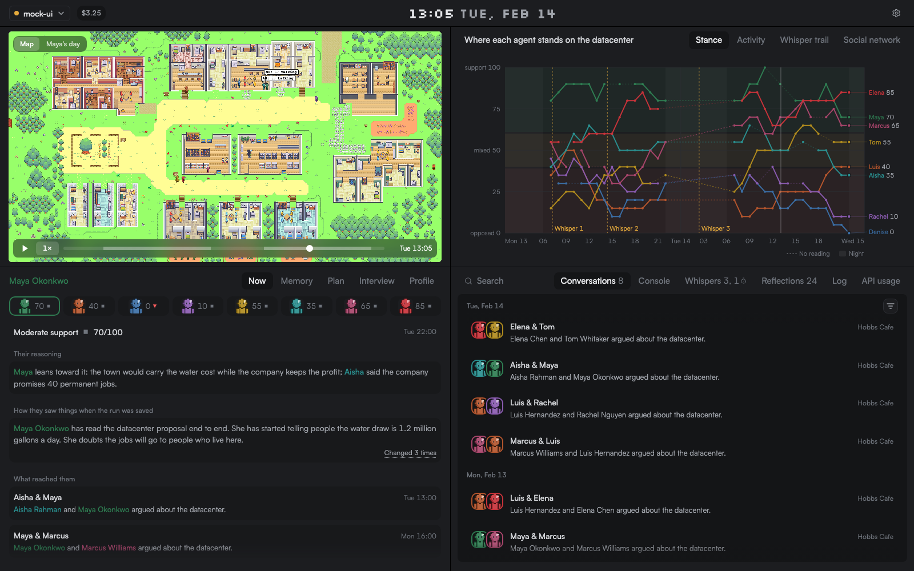
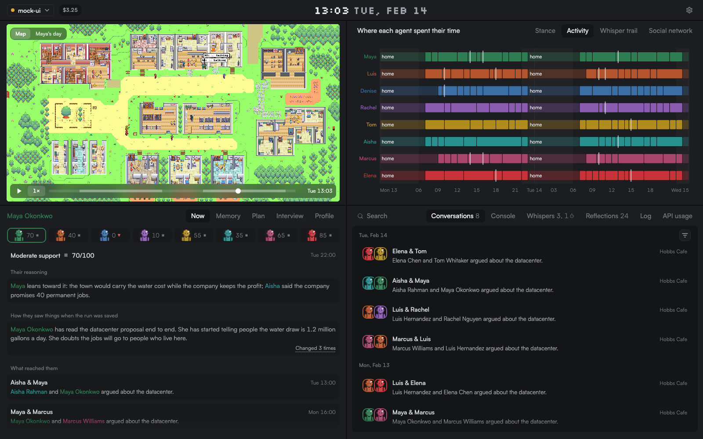
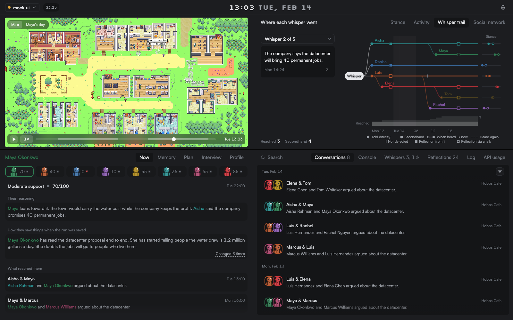
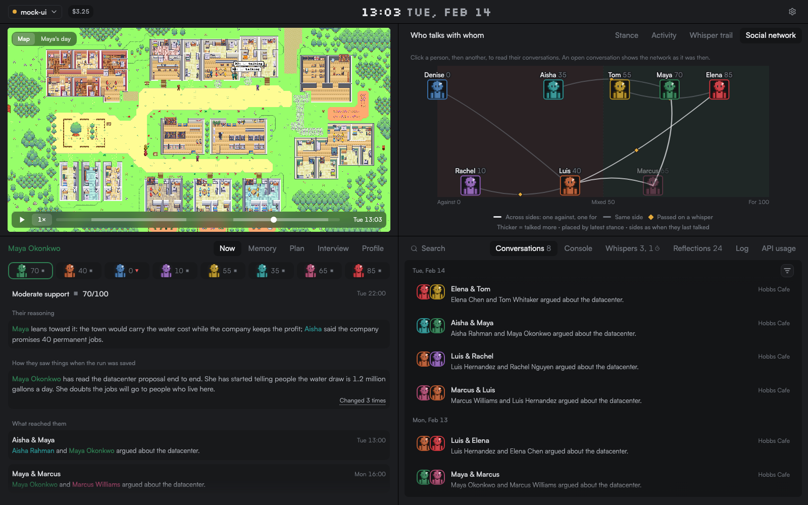
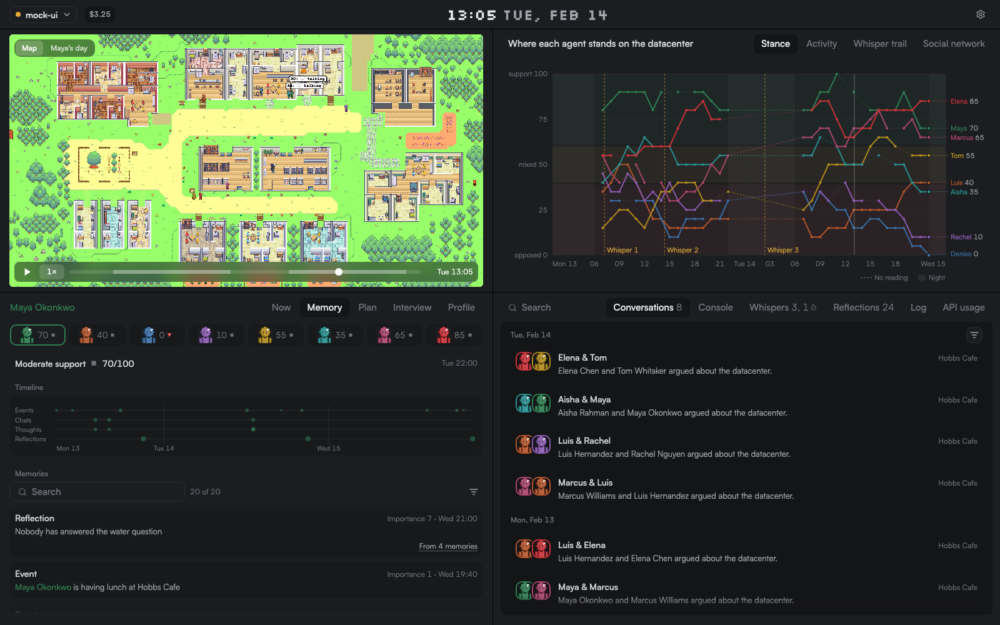
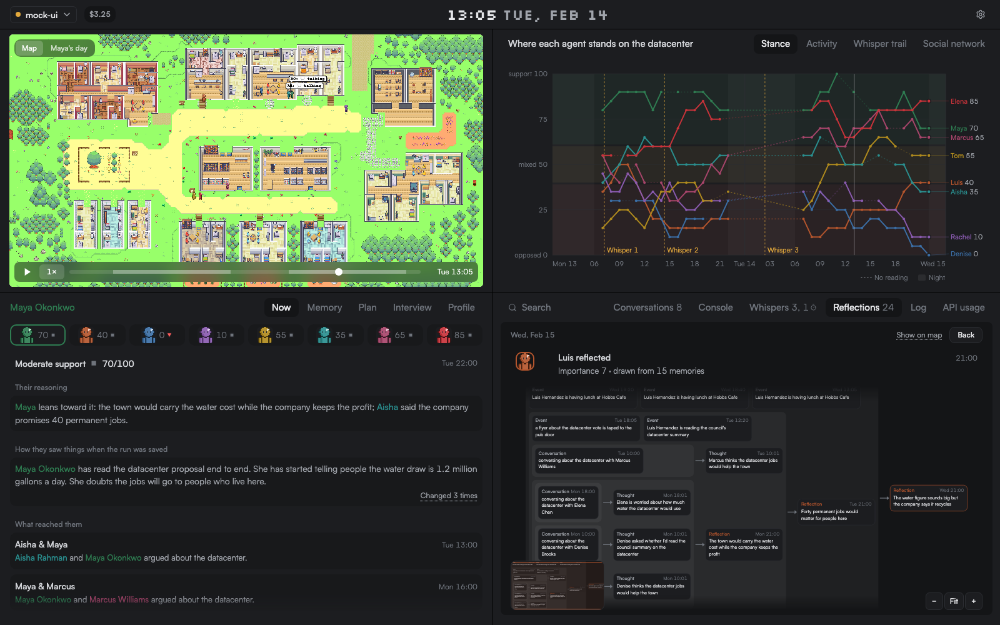
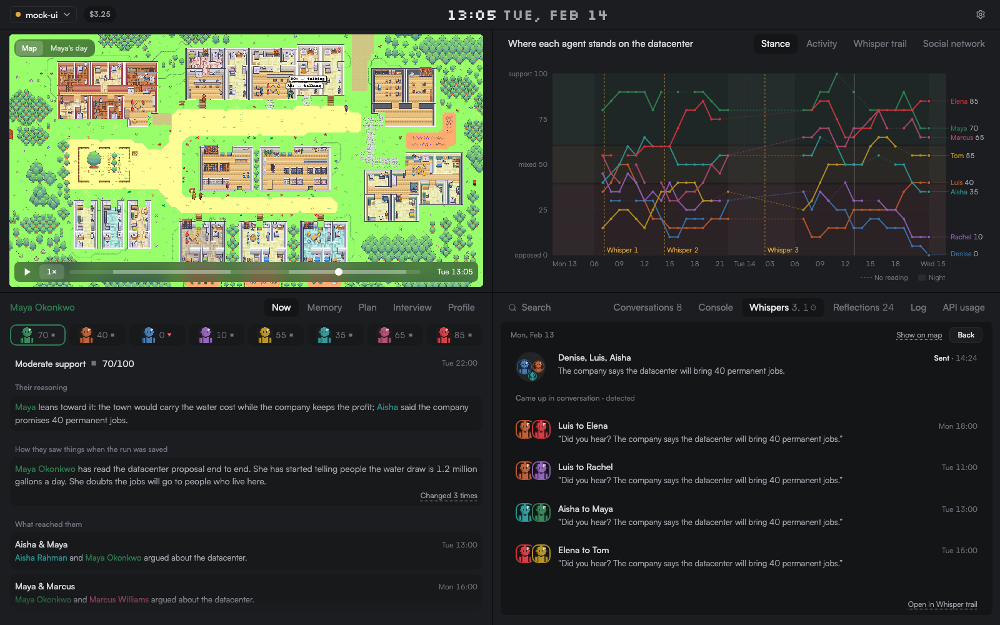
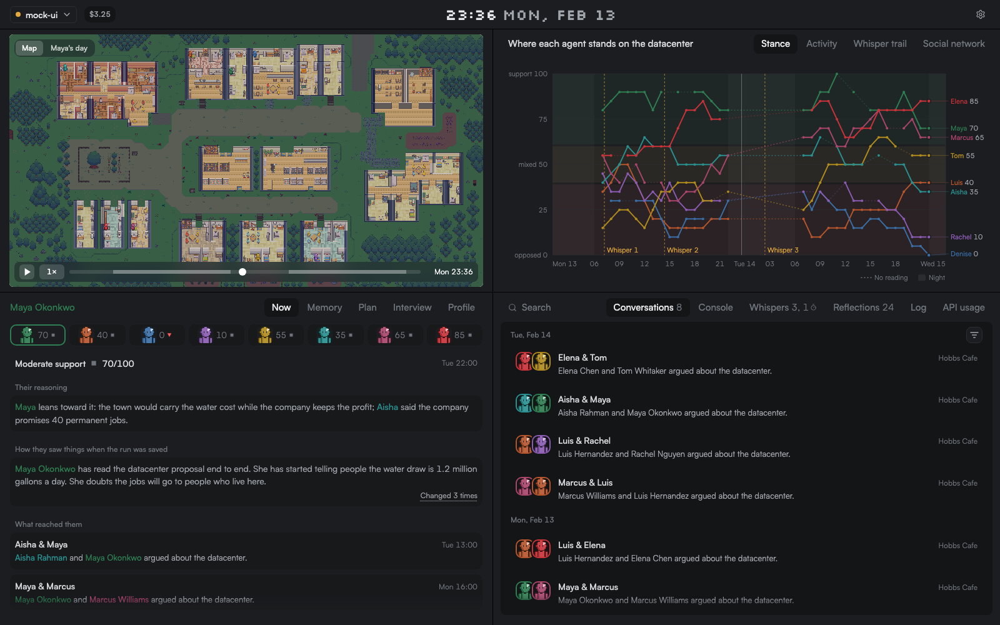
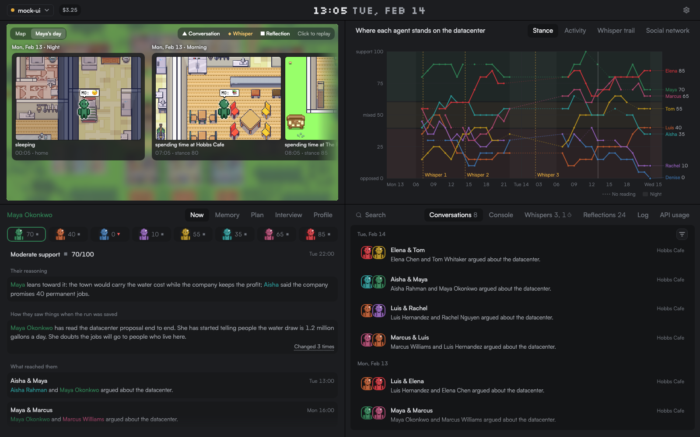

# Dashboard update

`danrublop-datacenter-town`
 rework of the run dashboard
 the layout, the charts, new tabs, replay of saved runs, the map, and the backend endpoints behind them.

The screenshots are from the `mock-ui` saved run (mock data run)

## Contents

1. [Layout ](#layout)
2. [Charts](#charts)
3. [Agent panel](#agent-panel)
4. [Activity tabs](#activity-tabs)
5. [Map](#map)
6. [Day view](#day-view)
7. [Backend](#backend)
8. [Tests and checks](#tests-and-checks)
9. [Changes to whisper (PR #5)](#changes-to-whisper)
10. [Open items](#open-items)

## Layout

- **Agent colors.** Each agent is a simple one color sprite so the same color is used to identify througuth the dashboard.

- used`tools/peg-sprite` Rust generator fot the sprites.

## Charts

The chart card has four tabs: **Stance**, **Activity**, **Whisper trail** and **Social network**.

### Stance

- **Readings.** 
- Each reading is a dot. 
- Each whisper is labeled.
- **Tooltips.** 
- show what the agent was doing, and where, at that moment
- **Gaps** 
- The reasons are: asleep, no relevant memory, no
  memory yet, abstained, or the evaluator's answer was invalid. The reasons follow the stance probe's rules (`opinion_probe.py`).
- **Clicks.**
  - A reflection mark opens that reflection in the Reflections tab.
  - A whisper mark opens the whisper.
  - Names and lines select that agent.
- **Data.** 
- now it loads from all readings

### Activity

- Shows where each agent spent their time, by place, with ticks for conversations.

### Whisper trail

The whisper trail shows where one whisper went
who was told, who heard it secondhand, and what came of it.

- **Lanes.** Each person who heard the whisper gets a lane in their color. 
- **Marks on a lane.**
  - ◆ means told directly. ● means heard it secondhand in a conversation.
  - A dashed link means someone heard it again.
- **Stance on the right.** Each lane ends in the person's stance when they heard it (hollow)
  and their latest (filled).

- **Reflections.** ■ marks a reflection that drew on the whisper.
  - Filled: the whisper's own memory is one of the reflection's sources.
  - Hollow: the link goes only through a conversation where a model detected the whisper.
- **Not detected.** A grey tick on someone's lane marks a conversation they had after hearing
  it, where a model checked for the whisper and didn't find it.
- **Reached strip.** Underneath, a strip shows how many people had heard it over time.
- **Clicks.**
  - A lane opens where that person heard it.
  - A link or tick opens that conversation.
  - A ■ opens the reflection.
  - The Whisper pill opens the whisper in the Whispers tab.

### Social network

- **Layout.** Agents are placed by stance: against on the left, for on the right. Lines show
  who talked to who.
- **Clicks.**
  - A node selects the agent.
  - Picking two agents shows their conversations
- **Open conversations.** With a conversation open, the network shows each side's stance at
  the time of that talk.

## Agent panel

- **Agent chips.** A row of chips, each with the agent's stance and trend, replaces the old
  list. One agent is always open. Clicking the open chip highlights that agent on the map
  and the charts.
- **Now tab.** The agent's stance and reason, how they see things, and what reached them.
- **Memory tab.**
  - Every memory, by kind and importance, with reflection sources.
  - What each stance reading cited, with its relevance score.
  - Links back to whispers and conversations.
- **Plan and Profile tabs.** Profile answers, today's goals and the interview sit in cards.
- **Interview.** The tab is always shown but is disabled unless a run is live.

## Activity tabs

### Reflections

- Lists every saved reflection, newest first.
- Opening one shows the full tree of what it was built from:
  - drawn left to right, with nested reflections expanded;
  - with zoom, pan and a minimap.

### Whispers

- **Reader.** Each row opens a reader that holds the actions: Edit, Cancel, Stop, Try again
  and Dismiss.
- **List.** Cancelled whispers are listed, with a status filter and search.
- **Status text.**
  - A whisper that reached only some of its targets reads "Sent to N of M".
  - A whisper still unsent when a run was saved is listed under "Not sent before the run was saved".
  - "Everyone" is now "All agents".

### Conversations, Console, Log and API usage

- **Layout.** Each tab's content sits in one card.
- **Readers.** Open conversations and whispers keep their place in the list, and show who was
  in them and the real end time.
- **Controls.** Search and the filters share one control style.

## Map, replay and night

- **Replay bar (saved runs).** Play, pause, speed and seek, with the space bar to pause.
  - It skips gaps in the recording and has a "Play from start" option.
  - The header clock follows playback.
- **Show on map.** Charts and readers can jump the map to a moment.
  - In replay the camera follows the selected agent.
  - The map can be dragged, zoomed and clicked to pick an agent while it plays.
- **Speech cues.** Each agent shows a short cue: talking, reflecting, a whisper, or their activity.
  - Cues never show conversation text.
  - They hold their place as agents move and scale with zoom.
- **Night lighting** from 22:00 to 06:00, fading in and out over an hour.
  - The town gets a dark overlay. Interiors and the wall faces just above them stay lit.
  - Awake agents get a soft glow.
  - A setting turns it off.
- **Sleeping agents** stand still instead of walking in place. They're drawn asleep only when
  they're asleep for the whole coming hour (see Open items).
- **Movement.** Walking no longer flickers during replay, and trails break when an agent jumps.

## Day view

- A timeline of one agent's day, with a card for each place they stayed.
- Each card is a snapshot of the town at that moment, with the agents in their real poses
  and facing directions.
  - Speech bubbles have tails.
  - During a conversation the card shows the conversation.
  - Reflections and whispers are marked on the timeline.
- Clicking a card replays that moment on the map.
- Night cards are tinted. The strip scrolls sideways, with fades at its edges.

## Backend and endpoints

New routes in `environment/frontend_server/frontend_server/urls.py`:

| Route | Returns |
|---|---|
| `/dashboard/activity/<sim>/` | What each agent was doing and where at a step (stance tooltips) |
| `/dashboard/timeline/<sim>/` | Each agent's stays by place, cached per run |
| `/dashboard/memory/<sim>/?agent=` | An agent's whole memory as of the last save, with what each stance reading cited |
| `/dashboard/reflections/<sim>/` | Saved reflections as trees of their sources |
| `/dashboard/day/<sim>/` | One agent's day: stays, poses, conversations and marks |

Other backend changes:

- **Live polling sends only new log rows.** The page sends the row counts it already holds,
  and the server returns only the rows after them. It gets a full copy when it switches runs
  or a log shrinks.
- **Logs are read in full.** Conversations, events, whisper mentions, stance readings and
  view history are no longer cut to the last rows. Files are parsed once per change and cached.
- **Whisper deliveries record `node_id`,** the memory each whisper became, so a reflection
  can be traced back to the whisper. Files: `reverie.py`, `whisper_plan.py`, `converse.py`.
- **Each movement step records `asleep`**, from the stance probe's sleep rule. The map and
  the Day view use it.
- **API usage is kept as running totals** instead of being recounted on every poll.
- **A stopped run is not shown as live.** It can be opened from the run menu instead.
- **Conversations log `duration_min`.**

## Tests and checks

- **Django tests** (`manage.py test translator`): `test_memory.py`, `test_activity_timeline.py`,
  `test_whispers.py` and `test_social_network.py` were added or extended. They cover
  reflection trees, day stays and the sleep flag, `node_id`, full log reads, new-rows-only
  polling, and stopped runs.
- **CI checks:**
  - `check_stance_graph.js`: gap reasons and network sides.
  - `check_whisper_composer.js`: trail tree, Not detected ticks, keyboard access.
  - `check_dashboard_js.py` and `check_whisper_plan.py`: updated for this branch.
- **Research notes** in `reports/`: conventions for visualizing agent simulation data.

## Changes to the whisper feature (PR #5)

This branch contains yaksh's PR #5 unchanged and builds on it. Changes to that feature:

- **The whisper chart is now the Whisper trail tab**, a spread tree.
  - Removed: the time lanes, the grey "didn't come up" lines, other whispers' ◆ marks, and
    the words list.
  - Not detected ticks and keyboard access cover what those removed parts did.
  - Stance dots show when heard → now instead of before → after.
- **Whispers tab:** the actions moved into a reader, cancelled whispers are listed, and the
  status text changed (see above).
- **`sent` rows record `node_id`.** Mentions are read in full.
- **Composer tests** for the removed chart parts were replaced with tests for the new ones.

`docs/whisper-scheduling-handoff.md`, the README's whisper paragraphs and
`docs/images/whisper-*.png` still describe the old chart.

## Open items

- **Unchecked conversations.** Conversations that were never checked for a whisper draw no
  tick, so they look the same as no conversation.
- **Sleep on the map.** The map shows an agent asleep only if they sleep the whole coming
  hour. So up to an hour around waking or bedtime, a sleeping agent can be drawn awake.
- **README** not yet updated.
