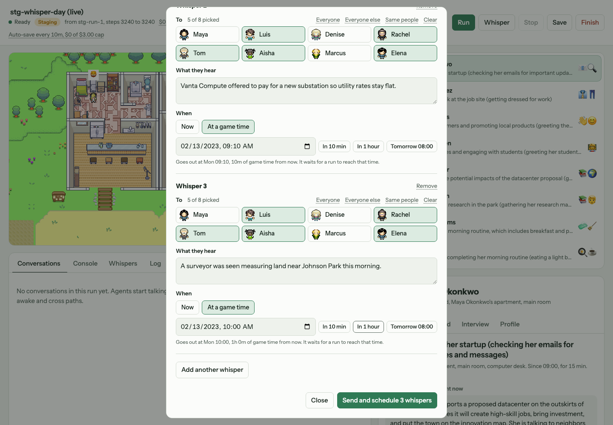
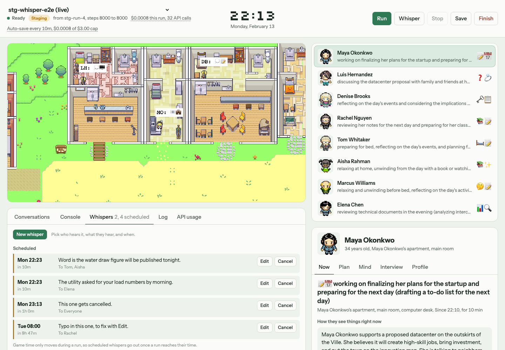
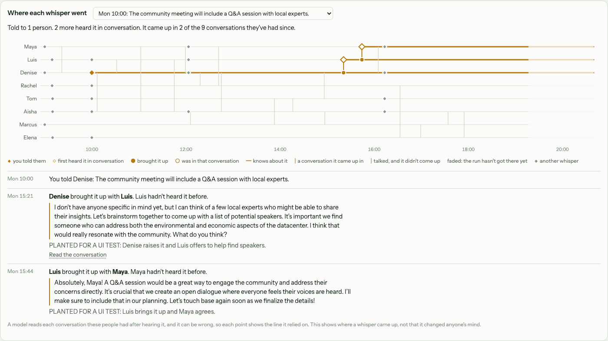

# Scheduled whispers and the whisper chart: handoff

Branch `yaksh-whisper-scheduler`. This is for whoever picks the work up next: what
was built, how it fits into the simulation, what was measured, and what is still
open. The short list of changes is in [CHANGELOG.md](../CHANGELOG.md).

Everything here was run on staging (`gpt-4o-mini`), not on a production model.

---

## 1. What it does

Before this, a whisper went to one agent at a time from the agent's Now tab, or
through the console. Either way it waited until the current run ended.

Now:

1. **Several whispers at once.** The Whisper dialog holds as many whispers as you
   like, each with its own people, text and time. "Three people hear one thing, the
   other five hear another, both at 14:00" is one dialog and one click.
2. **Scheduled or now.** Each whisper goes out now, or at a game time. Game time only
   moves during a run, so a scheduled whisper goes out when a run reaches its time.
3. **Mid-run.** A whisper added while a run is going reaches the agents at the next
   step. That holds for the dashboard, the console and the terminal.
4. **A chart of where each whisper went**: who you told, who heard it later in
   conversation, and the conversations it came up in.



*The dialog with three whispers in one batch: three people now, the other five at
09:10 (picked with **Everyone else**), and the same five at 10:00 (**Same people**).*



*The Whispers tab: scheduled whispers with Edit and Cancel, then what has been sent,
one row per whisper.*

---

## 2. How to read the chart



*The conversations in this screenshot are real, but the two mentions were planted to
show what the chart looks like, because no whisper came up on its own in the test
runs (see section 6). Their "how" lines say so.*

One whisper at a time, picked from the dropdown. Each row is a resident, and time
runs left to right.

| Mark | Meaning |
|---|---|
| ◆ amber diamond | You told them this whisper |
| ◇ hollow diamond | They first heard it in a conversation, from someone who knew it |
| ● filled dot | They brought it up in that conversation |
| ○ hollow dot | They were the other person in that conversation |
| amber line along a row | They know about it, from that moment on |
| amber vertical line | A conversation it came up in, joining the two people |
| grey vertical line | They talked, and it didn't come up |
| grey ◆ | Another whisper. Hover to read it, click to follow it instead |
| faded right-hand end | Game time the run hasn't reached yet |

Hover any mark to read the whisper, or the exact line where it came up, who said it,
and what the two of them did with it. Click a conversation to open its transcript in
the Conversations tab. A grey line's tooltip says why it's grey: it didn't come up,
neither of them had heard it yet, or that conversation wasn't checked.

Under the chart the same story is told in words, in time order ("You told Denise",
"Denise brought it up with Luis. Luis hadn't heard it before.", with the quote). That
list is also how a keyboard or screen reader user reads the chart. Every diamond and dot
can be reached with Tab, which shows its tooltip, and Enter opens it.

The chart shows **where a whisper came up, not that it changed anyone's mind.** The
stance chart above it marks each whisper with ◆ on the agent's line, for anyone who
wants to look at positions around the same moment.

---

## 3. How it works

### 3.1 The plan file

Everything goes through one append-only file per run,
`storage/<sim>/experiment/whispers.jsonl`, written by both processes. The dashboard
adds and cancels whispers. The simulation records what it delivered. Every status is
worked out from the rows (`whisper_plan.summarize`), so neither process rewrites the
other's work.

```
{"op": "add", "id", "text", "targets", "at", "replaces"}   at: game time, null for now
{"op": "cancel", "id"}
{"op": "started", "id", "time"}             delivery has begun, so too late to edit
{"op": "sent", "id", "agent", "step", "time"}
{"op": "failed", "id", "agent", "step", "time", "error"}
{"op": "saved", "step"}                      the agents' memory was saved here
```

`reverie/backend_server/whisper_plan.py` holds this logic and imports nothing else
from the backend, so Django loads it straight from its path, as it already does with
`llm/usage.py`. The frontend can't import the rest of the backend because that
reaches `utils.py` and the API keys.

Rows are written with one unbuffered `write`, so a row from the other process can't
land in the middle of a batch. The reader skips a last line that isn't finished yet.

### 3.2 Where delivery happens

```
dashboard / console / terminal ──append──▶ whispers.jsonl ◀──read── reverie
                                                                │
   step loop:  agents move ─▶ trace_whispers() ─▶ deliver_due_whispers() ─▶ step + 1
   idle:       every 0.5 s ─▶ deliver_due_whispers()
```

- **In the step loop**, delivery runs after every agent has moved, so the whisper is
  stamped with that step's time and the agents act on it from the next step.
- **When idle**, `open_server` waits for commands with a 0.5 second timeout and
  delivers anything due in between. A "now" whisper goes out straight away instead
  of waiting for the next run.
- **Console and terminal** `call -- whisper` lines are taken out of the command
  queue the same way `stop` already was (`CommandFeed._put`), and appended to the
  plan. Before this they waited behind a running `run` command.
- Delivery goes one recipient at a time. A `started` row goes first, which locks out
  edits, and a `sent` or `failed` row follows each recipient. One recipient failing
  costs nobody else their whisper, and doesn't end the run.
- **Spending cap.** Nothing goes out once the run has reached `budget_usd`. It waits
  until the cap is raised, and the Whispers tab shows "Waiting: spending cap reached".
- **Editing.** An edit is saved as a cancel and a new whisper that names the one it
  `replaces`. If the original had started going out, whoever already got it is left
  out of the edit, so nobody is told twice.
- **Billing.** Calls are tagged `source="whisper"`, so they show up separately in the
  API usage tab.

### 3.3 Forks

Starting a run from another one copies the plan file. The fork's agents only have the
memory from the parent's last save, so `forget_unsaved` drops `sent`, `failed` and
`started` rows written after the last `saved` row, and those whispers go out again in
the fork. A "now" whisper keeps the game time it first went out, so the fork hears it
at the same point in the story, not as soon as it loads. Anything still scheduled
carries over.

### 3.4 The whisper trace

`reverie/backend_server/whisper_trace.py` is an observer, like the stance probe. It
reads finished transcripts and never touches an agent. `ExperimentLogger` keeps this
step's conversations in `new_conversations`, and `trace_whispers` runs **before**
delivery: a conversation in the same step as a whisper happened before it, so it
can't have carried it.

For each conversation, it asks about every whisper that someone in the conversation
knew, whether they were told it or heard it second-hand:

1. `v3_ChatGPT/whisper_mention_v1.txt`: one question per whisper. The model lists
   what makes the information specific, looks for those details, and answers
   `came_up`, the line number, and one sentence on what the two people did with it.
2. On a yes, `v3_ChatGPT/whisper_mention_check_v1.txt` reads just two turns either
   side of that line and confirms the main claim is really there.

The quote stored is read from the transcript at that line number, never from the
model's own words. Both calls run at temperature 0. An answer that doesn't parse is
recorded as unchecked, not as a no. Someone who hears a whisper in conversation counts
as knowing it from then on, which is how the chart follows it from person to person.

Rows go to `storage/<sim>/experiment/whisper_mentions.jsonl`:

```
{"step", "time", "speakers", "checked": [ids], "failed": [ids],
 "mentions": [{"whisper_id", "speaker", "quote", "how", "new_hearers"}]}
```

**Cost:** one call per whisper per conversation that someone who knew it was in, plus
one more for each yes. A run with no whispers makes no calls. In the test runs that
came to 15 checks for 6 conversations, about $0.0035.

**Why not keyword or embedding matching.** Almost every conversation in this
simulation is about the datacenter, so anything that scores similarity flags most of
them. The first version asked about every whisper in one call, and it flagged most of
the list as mentioned. One question per whisper, with the specific details named
first, fixed that.

### 3.5 Whisper wording

This is a change to how agents behave, so it's called out separately.

The old prompt (`v2/whisper_inner_thought_v1.txt`) asked for "a statement about" the
agent, and the model made the agent the subject of the news. On `gpt-4o-mini`:

| Whisper to Tom | Old prompt stored | New prompt stores |
|---|---|---|
| The council published the water draw figure | Tom Whitaker published the water draw figure | Tom Whitaker heard that the council published the water draw figure |
| A surveyor was seen measuring land near Johnson Park | Tom Whitaker was seen measuring land | Tom Whitaker heard that a surveyor was seen measuring land |
| Your cousin lives near a facility like this one | Tom Whitaker lives near a facility like this one | Tom Whitaker's cousin lives near a facility like this one |

The old prompt got 5 of 7 news items wrong, and distorted some seed lines. The new one
(`v2/whisper_inner_thought_v2.txt`) kept all 7 news items and all 17 sampled seed lines
true to the text. One seed changed slightly: "who was consulted" became "who were
consulted". The examples in the prompt use the agent's own name, because a made-up
example name leaked into real memories in the first draft.

The same function also:

- stops storing an empty memory when the answer opens with a quote mark (9 such
  memories were found across the local runs);
- refuses the `TOKEN LIMIT EXCEEDED` error string and empty answers, so a failure is
  recorded as a failed whisper rather than stored as a memory;
- keeps quotes inside the whisper, and keeps only the first line of the answer;
- raises `max_tokens` from 50 to 1024, which is only a ceiling, so a 1000-character
  whisper isn't cut off.

---

## 4. Files

| File | What changed |
|---|---|
| `reverie/backend_server/whisper_plan.py` | **New.** Reads, writes and summarizes the plan file, finds what's due, handles forks. No backend imports. |
| `reverie/backend_server/whisper_trace.py` | **New.** Follows whispers into conversations. Read-only. |
| `reverie/backend_server/reverie.py` | `deliver_due_whispers`, `trace_whispers`, `plan_console_whisper`. Delivery hooked into the step loop and the idle loop. `call -- whisper` moved out of the command queue. `load history` loads one memory at a time. |
| `reverie/backend_server/dashboard_bridge.py` | `CommandFeed.get(timeout)` for the idle loop, and whispers taken out of band like `stop`. |
| `reverie/backend_server/experiment_logger.py` | Keeps this step's conversations for the trace. |
| `reverie/backend_server/persona/prompt_template/run_gpt_prompt.py` | Whisper wording v2 and its clean-up. The mention judge, its check, and their strict parsers. |
| `reverie/backend_server/persona/cognitive_modules/converse.py` | A whisper the model gave no usable thought for raises, rather than being stored as "...". |
| `.../v2/whisper_inner_thought_v2.txt`, `.../v3_ChatGPT/whisper_mention_v1.txt`, `.../v3_ChatGPT/whisper_mention_check_v1.txt` | **New** prompts. The old v1 whisper prompt stays on disk. |
| `environment/frontend_server/translator/dashboard.py` | `dashboard_whispers` and `dashboard_whisper_cancel`, with validation. `whispers` and `mentions` added to the live and saved-run payloads. |
| `environment/frontend_server/frontend_server/urls.py` | The two whisper routes. |
| `environment/frontend_server/templates/dashboard/dashboard.html` | The dialog, the Whispers tab, the chart, the header button. Presentation and API calls only. |
| `environment/frontend_server/translator/test_whispers.py` | **New.** 20 Django tests for the API. |
| `scripts/ci/check_whisper_plan.py` | **New.** Runs the real step loop, idle loop, command feed and trace against a throwaway folder, with stub agents and no API calls. |
| `scripts/ci/check_whisper_composer.js` | **New.** Runs the page's real whisper and chart functions under node. |
| `.github/workflows/ci.yml` | Both new checks wired in. |
| `README.md`, `CHANGELOG.md`, this file, `docs/images/` | Docs. |

---

## 5. Testing

### Automated, all in CI

```bash
python scripts/ci/check_whisper_plan.py          # plan, delivery, forks, console, trace, prompts
node scripts/ci/check_whisper_composer.js        # dialog labels and hints, Whispers tab, chart, tooltips
cd environment/frontend_server && python manage.py test translator   # 42 tests, 20 of them new
```

All of the existing checks still pass: `check_repo`, `check_retrieval`,
`check_opinion_probe`, `test_stance_rubric`, `check_memory_categories`,
`check_dashboard_js`, `check_stance_graph`, `compileall`, and `manage.py check`.

Each new rule was also broken on purpose, to confirm its check fails rather than just
passes. That covered over 40 cases, including: delivery never running, delivering early,
one failure ending the run, ignoring a cancel, forks keeping unsaved deliveries, the
spending cap being ignored, edits telling someone twice, logging before recording,
console whispers queuing behind the run, the trace running after delivery, asking
when nobody knew, counting no answer as a no, the trace touching an agent, and the old
whisper prompt coming back.

### By hand, with real runs (staging, `gpt-4o-mini`)

- Two groups of different whispers sent at once from the dialog reached all 8 agents.
- Whispers scheduled for 22:23 went out at exactly step 8058, which is 22:23:00.
- A whisper sent from the dashboard mid-run arrived during that run. A console
  whisper typed mid-run did the same, and the run carried on.
- Edit, Cancel, Stop, Try again and Dismiss all worked. So did the spending cap:
  whispers held at the cap and went out once it was raised.
- Killing the backend before a save and starting a new run from it re-sent the
  unsaved whisper exactly once.
- A saved run is read-only, and keeps its scheduled whispers when a new run starts
  from it.
- The chart's hover, real mouse click, keyboard focus and Enter worked, as did
  switching whispers. Checked in light and dark themes and at 390px wide.

Testing cost about $0.93 of API calls in all.

### Not tested

- Any production model. Everything ran on `gpt-4o-mini`.
- Runs longer than one game day. The chart's axis grows in steps of a quarter, and a
  long run hasn't been looked at.
- Browsers other than headless Chromium.

---

## 6. What the measurements say, and an open decision

### The mention judge

Measured on 340 pairs of whisper and conversation from two existing runs' real
transcripts, with gold answers written by reading them. It was right on 17 of its 18
flags, and found 17 of the 20 real mentions. Those same runs were used while writing
the prompts, so read this as a best case. On 62 real checks from the test runs it
flagged nothing, which was correct. How often it finds a real mention in use is not
measured yet, because none happened (below).

So treat a mention as good evidence, not proof. That is why each one shows the exact
line it relied on.

The measurement script and gold sets weren't committed, because they depend on run
folders that aren't in git.

### Agents rarely repeat a whisper

Across 21 daytime conversations in two test runs, with 8 whispers, **no whisper came
up in conversation.** One was worded "you want to tell everyone you talk to". This
was checked by reading the transcripts, not just from the trace.

A read-only replay of the retrievals in `agent_chat_v2` suggests why. The whisper does
reach the list of memories the next line of speech is written from: roughly 8th of 15
in one of its three retrievals. But that list is about 40 memories long, and the model
doesn't pick the whisper up. The replay is approximate: `last_accessed` isn't saved,
so recency can't be reproduced exactly.

**Decision for the team.** Getting agents to voice whispers more means changing
cognition: retrieval, or the conversation prompt. That would change behaviour and
break comparability with earlier runs. This branch doesn't do it. Until someone
decides, expect most whispers to show only grey lines on the chart. "Agents rarely
pass on what they're told" may be a result worth keeping in its own right.

---

## 7. Known limitations and open items

- **Duplicate Sent rows after a crash.** After a crash and a continue, a whisper
  re-sent in the fork can be listed twice under Sent. The fork's copy of
  `events.jsonl` keeps the parent's unsaved row. The same thing already happens with
  conversations and other logs, so it isn't specific to whispers.
- **Header overflow on phones.** The page header's run picker overflows at phone
  width. This predates the branch. The new chart fits.
- **Polling reads.** The dashboard reads the whole plan, and up to 2000 rows of
  mentions, on every poll of about one second. That matches how it already reads
  conversations and stance readings, and is fine at the sizes seen so far.
- **Old whisper rows.** Whispers sent before this branch, through the old console
  path, aren't in any plan file. They show in the Sent list and on the stance chart,
  but not on the whisper chart.
- **Seed memories without a run.** Loading seed memories still needs a loaded run, as
  before. To plan whispers before running, start the run with 0 steps.
